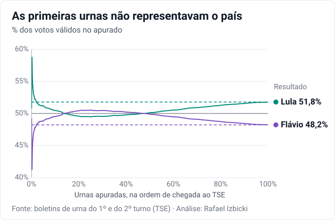
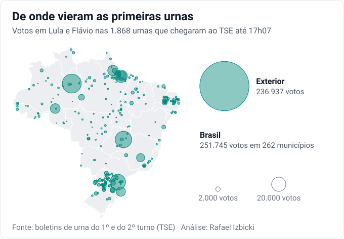
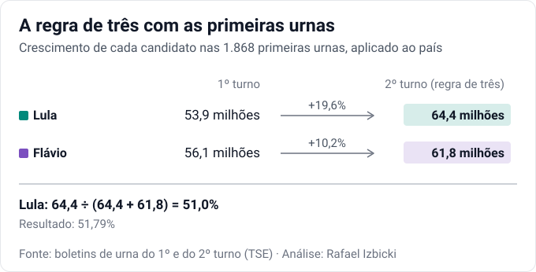
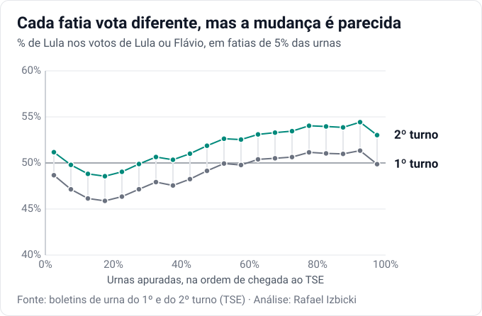
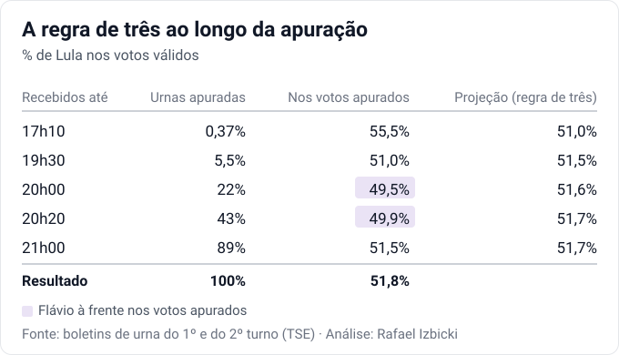

[Escrevi no X](https://x.com/rizbicki/status/2115406607437717524) que acertar o resultado com 1% das urnas
apuradas é, em certo sentido, fácil: é como uma amostra estratificada gigante, com mais de um milhão de votos.
Basta saber onde há homogeneidade e quais são os pesos. Muita gente respondeu que isso é besteira, porque as
primeiras urnas não representam o país.

Elas de fato não representam. Mas isso não impede uma boa projeção. Neste texto, mostro que uma regra de três
simples, usando o 1º turno, já resolve boa parte do problema, e que por trás dela há um modelo estatístico
razoável.

## As primeiras urnas não representavam o país

Com 0,37% das urnas apuradas, Lula tinha 55,5% dos votos válidos. Entre 14% e 47% das urnas, quem esteve à
frente foi Flávio. O resultado final foi Lula com 51,79%.

Não é difícil entender por quê. As 1.868 urnas que chegaram ao TSE logo depois das 17h vieram de poucos lugares:
49% dos votos eram do exterior, 44% dos demais do Norte, e nenhum de São Paulo ou do Rio.

## A amostra não precisa ser representativa

Uma amostra não precisa se parecer com a população para ser útil. Basta saber de que forma ela é diferente, e o
1º turno mostra isso. As mesmas 1.868 urnas já davam a Lula, no 1º turno, 53,5% dos votos dados a ele ou a
Flávio, contra 49,0% no país: 4,5 pontos a mais. No 2º turno, deram a ele 55,5%, contra 51,8% no país.

Ou seja, o apurado das primeiras urnas não estava errado por acaso. Ele vinha de urnas que já votavam mais em Lula
do que o resto do país, e o tamanho desse desvio era conhecido desde o 1º turno.

## A regra de três

Uma primeira aproximação para fazer essa correção é uma regra de três. Ela supõe que cada candidato cresce no
país, do 1º para o 2º turno, o mesmo que cresceu nas urnas já apuradas. As urnas apuradas não precisam votar
como o país, só mudar como ele.

Nas primeiras urnas, Lula foi de 227 mil votos no 1º turno para 271 mil no 2º, um crescimento de 19,6%. Flávio
foi de 197 mil para 217 mil, um crescimento de 10,2%. Aplicando esses crescimentos aos votos de cada um no país no
1º turno, 53,9 milhões para Lula e 56,1 milhões para Flávio, Lula fica com 64,4 milhões e Flávio com 61,8
milhões. Isso dá 51,0% para Lula.

Depois da apuração, dá para verificar se a suposição era razoável. Dividindo as urnas em 20 fatias pela ordem de
chegada, cada fatia vota de um jeito: no 1º turno, Lula vai de 45,9% a 51,3% dos votos dados a ele ou a Flávio,
conforme a fatia. Mas a mudança do 1º para o 2º turno é parecida em todas, de 2,5 a 3,2 pontos.

## A projeção ao longo da apuração

Refazendo a conta com a ordem real de chegada dos boletins ao TSE, a projeção errou por 0,8 ponto com 0,37% das
urnas apuradas, por 0,3 ponto com 5,5% e por 0,2 ponto com 22%. Por volta das 20h, quando Flávio estava à frente
no apurado, ela dava Lula com 51,6%.

## Um modelo por trás da regra de três

A regra de três não é só uma conta conveniente. Ela sai de um modelo estatístico razoável.

Considere um candidato, e sejam $V_{1i}$ e $V_{2i}$ os votos dele na urna $i$ no 1º e no 2º turno. O modelo é

$$V_{2i} \mid V_{1i} \sim \mathrm{Poisson}(\theta V_{1i}),$$

isto é, em média o candidato multiplica os votos que teve no 1º turno por uma mesma taxa $\theta$ em todas as
urnas.

Seja $A$ o conjunto das urnas já apuradas. A suposição sobre a ordem de chegada é que ela pode depender de como
cada urna votou no 1º turno, mas, dado isso, não do voto no 2º. Em linguagem técnica, os votos que faltam são
faltantes ao acaso (*missing at random*) dado o 1º turno. Com isso, as urnas apuradas bastam para estimar $\theta$. A log-verossimilhança
é $\sum_{i \in A} \left( V_{2i} \log \theta - \theta V_{1i} \right)$ mais uma constante, e o estimador de máxima
verossimilhança é

$$\hat\theta = \frac{\sum_{i \in A} V_{2i}}{\sum_{i \in A} V_{1i}},$$

o crescimento do candidato nas urnas apuradas. O total previsto do candidato soma o que já foi apurado à previsão
para as urnas que faltam:

$$\hat T = \sum_{i \in A} V_{2i} + \hat\theta \sum_{i \notin A} V_{1i} = \hat\theta \sum_{i} V_{1i}.$$

É a regra de três: os votos do candidato no país no 1º turno vezes o crescimento dele nas urnas apuradas. A
projeção de Lula é $\hat T_{\text{Lula}} / (\hat T_{\text{Lula}} + \hat T_{\text{Flávio}})$.

A distribuição de Poisson não é essencial. O mesmo $\hat\theta$ sai de mínimos quadrados ponderados, supondo
apenas que, dado $V_{1i}$, $V_{2i}$ tem média $\theta V_{1i}$ e variância proporcional a $V_{1i}$. Em amostragem, ele é conhecido
como estimador razão.

## Modelos mais completos

Modelos mais sofisticados, como o de Rodrigo Mahlmeister, [publicado pelo Estadão](https://projecao.2026elections.workers.dev),
partem da mesma ideia com suposições mais realistas: deixam a taxa $\theta$ variar com o perfil do local de
votação, como estado, região e porte do município, e usam também o 2º turno de 2022. Isso levou a resultados
melhores, sobretudo no começo da apuração, e dá à projeção uma margem de incerteza.

O modelo dele também projeta a curva da apuração até 100%, com uma suposição adicional sobre a ordem das urnas
que faltam: cada estado mantém o ritmo de apuração dos últimos 15 minutos. Com isso, consegue indicar se a
liderança no apurado deve virar.

---

*Dados: boletins de urna do 1º e do 2º turno de todas as seções, com o horário de recebimento de cada boletim,
dos dados abertos do TSE (dadosabertos.tse.jus.br). Quando a agregação de seções (os eleitores de uma seção votam
na urna de outra) muda entre os turnos, as seções envolvidas foram tratadas como uma unidade só.*
