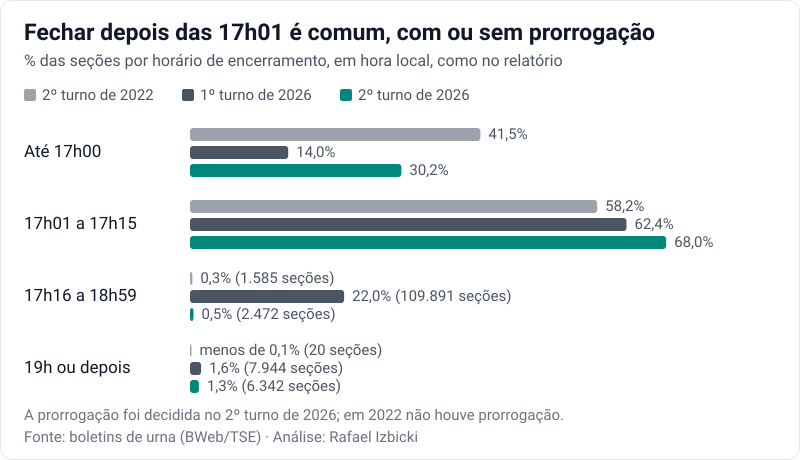
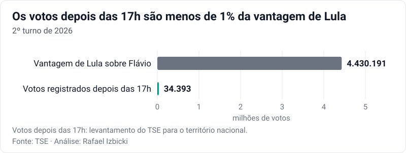
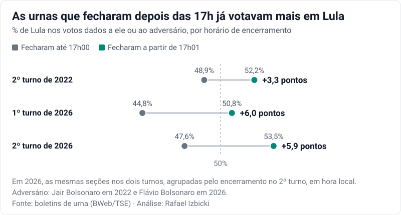
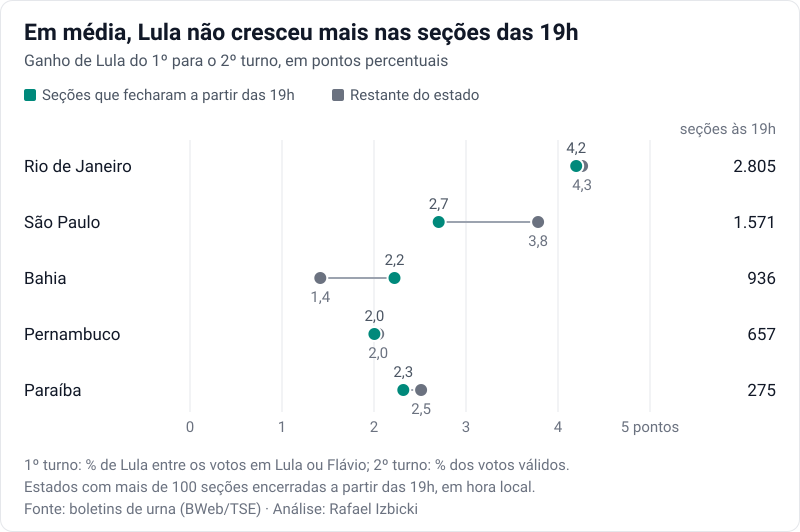
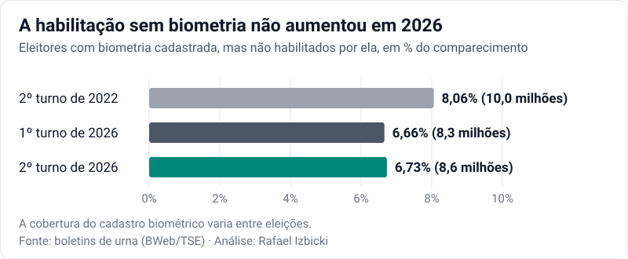
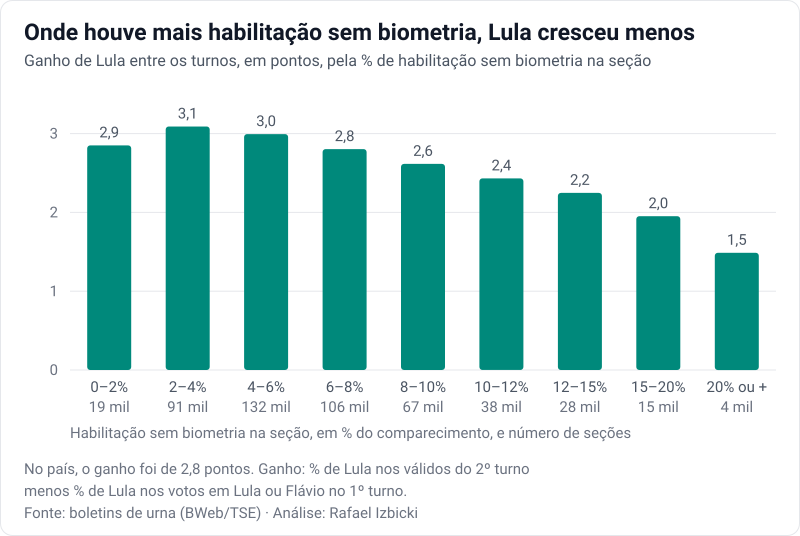
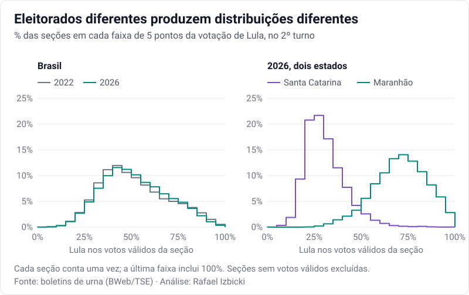
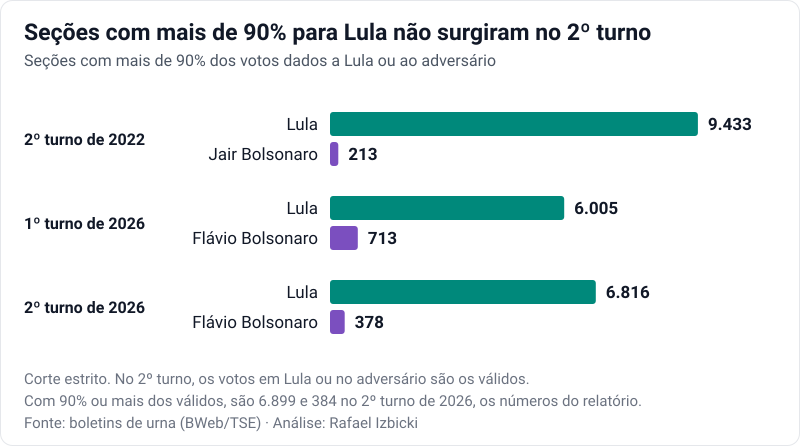
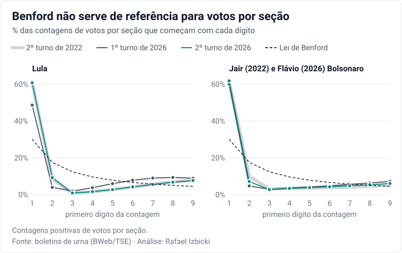

Um jornalista me pediu para avaliar um documento que circula com o título "Relatório Pericial Independente".
Com base nos boletins de urna do 2º turno, o texto conclui que a vitória de Lula foi "fabricada" nas urnas que
encerraram depois das 17h. Também trata como suspeitos os eleitores habilitados sem reconhecimento biométrico,
o número de seções quase unânimes para Lula e a distribuição dos dígitos dos votos.

Refiz as contas com os mesmos dados públicos do TSE. Os padrões que o relatório apresenta como prova de fraude
não indicam fraude. Eles aparecem também no 2º turno de 2022, quando não houve prorrogação, e no 1º turno de
2026, antes dela. Para cada ponto, cito primeiro o que o relatório afirma e depois mostro por que a conclusão
não se sustenta.

## As urnas que fecharam depois das 17h

> **O que o relatório afirma**
>
> Nas urnas encerradas até as 17h, Flávio Bolsonaro teve 52,39% dos votos válidos e quase 1,8 milhão de votos
> de vantagem. Nas encerradas depois, Lula teve mais de 6,1 milhões de vantagem. Daí o relatório conclui que
> "a vitória de Lula foi fabricada exclusivamente no universo de urnas que encerraram as votações após o
> horário limite legal".

**Por que não se sustenta.** O horário de encerramento não diz quando os votos foram dados. Uma seção que
recebeu 300 eleitores durante o dia e fechou às 17h05 entra inteira no segundo grupo, com seus 300 votos.

### Fechar depois das 17h é comum

Às 17h, os mesários distribuem senhas a quem está na fila e encerram a urna depois do último voto, como
descreve a
[orientação do TSE](https://www.tse.jus.br/comunicacao/noticias/2026/Agosto/conheca-os-procedimentos-que-garantem-o-encerramento-seguro-das-eleicoes).
Das 348 mil seções do segundo grupo, 340 mil fecharam até 17h15, como mostra a própria tabela do relatório.
Em 2022, sem prorrogação, 58% das seções fecharam entre 17h01 e 17h15. No 1º turno de 2026, que não teve a
prorrogação do 2º, foram 62%, e outros 22% fecharam entre 17h16 e 18h59. No 1º turno há mais cargos para
votar, e as filas costumam ser maiores.

No 1º turno de 2026, 7.944 seções fecharam a partir das 19h, mais do que as 6.342 do 2º turno.

### Os votos dados depois das 17h

Quantos votos foram dados depois das 17h está registrado no log de cada urna, que guarda o horário de cada
voto, mas não o candidato escolhido. Nas 348 mil seções que fecharam a partir de 17h01, com 90,6 milhões de
votantes, os logs registram 31.033 votos depois das 17h. O
[levantamento do TSE](https://www.tse.jus.br/comunicacao/noticias/2026/Outubro/eleicoes-2026-mais-de-34-mil-votos-foram-registrados-apos-as-17h-no-2o-turno)
conta 34.393 em todo o território nacional.[^logs] Parte desses eleitores já estava na fila às 17h e tinha
direito de votar pela regra normal; pelos logs, 89% desses votos foram registrados até 17h15. Mesmo que todos
fossem de Lula e fossem retirados, sua vantagem ainda seria de 4.395.798 votos.

### As mesmas seções já votavam diferente antes da prorrogação

Se a prorrogação tivesse acrescentado votos a Lula, seria de esperar que as seções que fecharam mais tarde
mudassem mais entre os turnos do que as outras. Não foi o que aconteceu. No 1º turno, as mesmas seções já davam a Lula 44,8% e
50,8% dos votos dados a ele ou a Flávio, uma diferença de 6,0 pontos. No 2º turno, a diferença foi de 5,9
pontos. Lula cresceu 2,8 pontos nos dois grupos.

A divisão pelo horário de encerramento separa vencedores diferentes em todas as votações. Em 2022, Jair
Bolsonaro teve 51,1% dos votos válidos nas urnas que fecharam até 17h00, com 1,04 milhão de votos de vantagem;
Lula teve 52,2% nas que fecharam depois, com 3,18 milhões de vantagem. No 1º turno de 2026, agrupando as seções
pelo horário em que fecharam naquele turno, Lula teve 38,8% dos votos dados a ele ou a Flávio nas que fecharam
até 17h00 e 50,5% nas demais.

Parte da diferença entre os grupos é geográfica. O relatório usa a hora local. No Acre, no Amazonas, em Mato
Grosso, em Mato Grosso do Sul, em Rondônia e em Roraima, a votação termina às 15h ou 16h locais, que são 17h em
Brasília. Por isso, praticamente todas as 32 mil seções desses estados caem no grupo que fechou até 17h00.
Nelas, Flávio teve 59,7% dos votos válidos, e são delas 1,44 milhão dos seus 1,75 milhão de votos de vantagem
nesse grupo. No resto do Brasil, nenhuma urna fechou antes das 17h de Brasília; ali, o primeiro grupo reúne as
urnas que fecharam ainda no minuto das 17h00.

Qualquer divisão das seções em grupos com eleitorados diferentes pode dar um vencedor diferente em cada um, como
Nordeste e Sul, ou capital e interior. Isso não diz nada sobre a regularidade dos votos de nenhum dos grupos.

## As seções que fecharam depois das 19h

> **O que o relatório afirma**
>
> O número de 34 mil votos depois das 17h, divulgado pela imprensa, seria um mito: "mais de dois milhões e meio
> de eleitores votaram em urnas que extrapolaram os limites normais". Nas seções que fecharam depois das 19h, Lula teria
> atingido "índices avassaladores": 72,31% na Bahia, 65,70% em Pernambuco, 83,31% no Maranhão e 57,46% em São
> Paulo.

**Por que não se sustenta.** De novo, são eleitores que votaram ao longo do dia. Nas 6.342 seções que fecharam
a partir das 19h, com 1,86 milhão de votantes, os logs registram 4.484 votos depois das 17h.

A seleção de estados também engana. Ela deixa de fora o Rio de Janeiro, o estado com mais seções nesse grupo,
2.805; ali, quem venceu foi Flávio, e Lula teve 45,8%. Em Pernambuco, Lula teve menos nessas seções do que no
estado inteiro, que lhe deu 69,2%. No Maranhão, os 83,3% vêm de três seções, com 634 votantes. Em São Paulo,
1.481 das 1.571 seções ficam na capital, onde Lula vai melhor do que no interior. No 1º turno, essas mesmas
seções já lhe davam 54,8% dos votos dados a ele ou a Flávio, contra 42,4% no estado.

Seções que fecham tarde votarem mais em Lula também não depende da prorrogação. No 1º turno de 2026, as 7.944
seções que fecharam a partir das 19h deram a ele 70,7% dos votos dados a ele ou a Flávio, mais do que os 55,2%
das seções das 19h no 2º turno.

Comparar essas seções com o estado inteiro mistura o horário com as diferenças entre eleitorados. A comparação
mais informativa é, de novo, a mudança entre os turnos: se a prorrogação tivesse acrescentado votos a Lula,
seria de esperar que ele crescesse mais nessas seções do que no restante do estado.

Considerando todos os estados, ponderados pelos votos, as seções das 19h tiveram um ganho 0,17 ponto menor do
que o restante do seu estado. No Rio de Janeiro, em Pernambuco e na Paraíba, o ganho foi praticamente o mesmo;
em São Paulo, foi menor. Na Bahia, a diferença de 0,8 ponto nessas seções equivale a pouco mais de 2 mil votos,
num estado em que Lula teve 3,9 milhões de votos de vantagem.

Uma comparação nacional que não separa os estados engana: 45% dos votos dessas seções estão no Rio de Janeiro,
onde Lula cresceu mais do que a média do país em todas as seções. Por isso, sem separar os estados, o ganho
nelas fica em 3,2 pontos, contra 2,8 nas demais.

## A habilitação sem biometria

> **O que o relatório afirma**
>
> 8.632.488 eleitores, 6,73% do comparecimento, foram "liberados sem biometria", "quase o dobro da diferença
> total da eleição". A liberação manual teria sido "explorada em escala inédita no segundo turno", em seções
> sem fiscais da oposição.

**Por que não se sustenta.** Esses 8.632.488 eleitores tinham biometria cadastrada, mas não foram habilitados
por ela. Isso não quer dizer que votaram sem identificação. Quando a digital não é reconhecida, a
[regra de identificação](https://www.tse.jus.br/legislacao/compilada/res/2026/resolucao-no-23-751-de-26-de-fevereiro-de-2026)
prevê a conferência da identidade e procedimentos alternativos, incluindo assinatura no caderno e habilitação
com a digital do mesário.

A comparação com a margem de 4,4 milhões não mede nada: o tamanho de um grupo de eleitores identificados por
outro procedimento não informa em quem eles votaram. Esse grupo também não cresceu em 2026. No 1º turno, foram
8,3 milhões, 6,66% do comparecimento; no 2º turno de 2022, 10,0 milhões, 8,06% do comparecimento.

O relatório diz ter testado a correlação entre essas habilitações e a votação de Lula, mas não mostra o
resultado. Se elas tivessem sido usadas para acrescentar votos a Lula, seria de esperar que ele crescesse mais
entre os turnos nas seções com mais habilitações sem biometria. Os dados mostram o contrário: onde menos de 6% dos eleitores foram
habilitados assim, Lula cresceu cerca de 3 pontos; onde foram mais de 15%, 2 pontos ou menos.

O padrão se mantém entre seções do mesmo estado e com a mesma votação no 1º turno: cada ponto percentual a
mais de habilitações sem biometria está associado a 0,045 ponto a menos no ganho de Lula (intervalo de 95%:
de 0,037 a 0,052 ponto a menos). Uma associação positiva daria algum apoio à acusação; a observada vai na
direção oposta. Quanto aos fiscais, os boletins não trazem nenhuma informação sobre eles.

## As seções quase unânimes

> **O que o relatório afirma**
>
> Os percentuais por seção deveriam seguir "distribuições gaussianas suaves em torno da média". As 6.899 seções
> com 90% ou mais dos votos válidos para Lula, contra 384 para Flávio, seriam uma "desproporção aberrante de
> dezoito para um". Essas seções coincidiriam com "zonas rurais de baixíssima fiscalização partidária
> independente, onde a taxa de liberação sem biometria atinge seus picos mais elevados". O relatório também
> aponta 106 seções com 100% dos votos válidos para Lula e quatro para Flávio.

**Por que não se sustenta.** Não há motivo para essa curva. Uma seção do interior do Maranhão e uma de Santa
Catarina não são amostras de um mesmo eleitorado nacional. Juntar eleitorados com preferências tão diferentes
produz uma distribuição assimétrica, com muitas seções longe da média do país.

A assimetria também não é nova. Em 2022, havia 9.433 seções com mais de 90% dos votos válidos para Lula e 213
para Jair Bolsonaro. No 1º turno de 2026, contando só os votos em Lula ou Flávio, eram 6.005 para Lula e 713
para Flávio.

E as seções de 2026 com mais de 90% para Lula já votavam assim antes da prorrogação: 6.811 das 6.816 lhe
deram mais de 80% dos votos dados a ele ou a Flávio no 1º turno.

As seções unânimes são pequenas. As 106 com 100% para Lula somam 14.860 votos válidos, com mediana de 125 por
seção, contra 198 nas seções com mais de 90%. Com poucos votos, é mais fácil que todos vão para o mesmo
candidato. Todas as 106 já tinham dado a Lula mais de 90% dos votos dados a ele ou a Flávio no 1º turno. Em
2022, havia mais seções unânimes: 143 para Lula e quatro para Jair Bolsonaro.

Nas seções com mais de 90% para Lula, de fato houve mais habilitações sem biometria: 8,4% dos eleitores,
contra 6,9% se essas seções tivessem a taxa das demais seções do seu estado. Mas essa diferença não é nova.
No 1º turno, as seções com mais de 90% para Lula tinham 8,3%, contra 6,7%; em 2022, 13,5%, contra 8,8%. Nas
106 seções unânimes, a taxa foi de 5,0%, abaixo da média nacional de 6,7%. Os boletins não indicam se uma
seção é rural nem se havia fiscais, e as três variáveis que o relatório diz ter cruzado não incluem nenhuma
das duas informações.

## A lei de Benford

> **O que o relatório afirma**
>
> As 499.205 seções foram submetidas "ao teste forense do primeiro dígito significativo de Benford, uma
> ferramenta matemática consagrada internacionalmente para detectar manipulação ou artificialidade em dados
> estatísticos massivos".

**Por que não se sustenta.** O relatório não apresenta o resultado do teste. Mesmo que apresentasse, seria
preciso justificar por que essas contagens deveriam seguir a lei, e não há razão para esperá-la aqui. O número
de votos de um candidato numa seção depende do tamanho da seção, que tem algumas centenas de eleitores, e da
parcela que ele recebe ali. Se um candidato recebe cerca de metade de 300 votos, sua contagem começa por 1. Por isso, no 2º turno, nos dois anos
e para os dois candidatos, cerca de 61% das contagens começam por 1, bem acima dos 30% da lei de Benford, que
não se aplica a esse tipo de dado.

O 1º turno de 2026 mostra o mecanismo. Com mais candidatos, Lula teve menos votos por seção, e a fração das
suas contagens que começa por 1 cai para 49%. O primeiro dígito acompanha o tamanho típico das contagens.

A adequação desses testes a dados eleitorais é discutida, por exemplo, por
[Deckert, Myagkov e Ordeshook](https://doi.org/10.1093/pan/mpr014).

## A disponibilidade dos dados

> **O que o relatório afirma**
>
> Os microdados de cada urna "foram trancados em sigilo técnico por quase três dias", e a liberação dos
> arquivos de boletim de urna (BWeb) "ocorreu apenas na manhã desta quarta-feira, 28 de outubro".

**Por que não se sustenta.** Os arquivos consolidados por estado, que o relatório diz ter usado, trazem no
nome a data em que foram gerados, segunda-feira, 26, às 7h42, e foram registrados no
[portal de dados abertos do TSE](https://dadosabertos.tse.jus.br/dataset/resultados-2026-boletim-de-urna) na
terça-feira, 27. É o mesmo prazo de antes: os arquivos do 1º turno de 2026 e do 2º turno de 2022 também foram
registrados na terça-feira seguinte à votação. E os boletins e os logs de cada urna já podiam ser baixados
antes disso: eu os usei [na manhã de segunda-feira](https://x.com/rizbicki/status/2114734442983915700) para contar os votos registrados depois das 17h.

## O que essas contas permitem dizer

Os padrões apontados pelo relatório não demonstram a fraude alegada, e nenhum deles é novo.

Sobre a prorrogação, há uma medida direta: os votos registrados depois das 17h são poucos demais para mudar o
resultado, mesmo que todos fossem de Lula. Além disso, as seções que fecharam depois das 17h não deram a Lula
um ganho maior entre os turnos; as que fecharam depois das 19h, em média, também não, comparadas às demais
seções do mesmo estado. Sobre biometria e seções quase unânimes, o relatório não apresenta nenhuma comparação
que separe uma irregularidade de diferenças entre eleitorados. As comparações feitas aqui também são
associações entre seções: não verificam o que aconteceu em cada uma, mas não mostram o padrão que daria apoio à
acusação. As alegações políticas do documento não são objeto desta análise.

---

*Dados: boletins de urna consolidados (BWeb) do
[2º turno de 2022](https://dadosabertos.tse.jus.br/dataset/resultados-2022-boletim-de-urna) e dos
[dois turnos de 2026](https://dadosabertos.tse.jus.br/dataset/resultados-2026-boletim-de-urna), cargo de
presidente, e logs das urnas do 2º turno de 2026. Os 84 arquivos foram conferidos contra os SHA-512 publicados
pelo TSE, e os votos de cada candidato e o comparecimento, somados seção por seção, batem exatamente com os
totais oficiais. Os grupos por horário seguem o relatório: hora local, com resolução de um minuto (até
17h00min59s e a partir de 17h01min00s). O exterior entra nos totais. No 1º turno, a votação de Lula é medida
entre os votos dados a ele ou a Flávio.*

[^logs]: Pelos logs, com o fuso de cada município, há 34.050 votos estritamente depois das 17h no Brasil, além
    de 416 no exterior. A tabela do TSE é reproduzida exatamente, estado por estado, contando os votos a partir
    de 17h00min00s e usando um único fuso por estado. A diferença não altera nenhuma conclusão.
